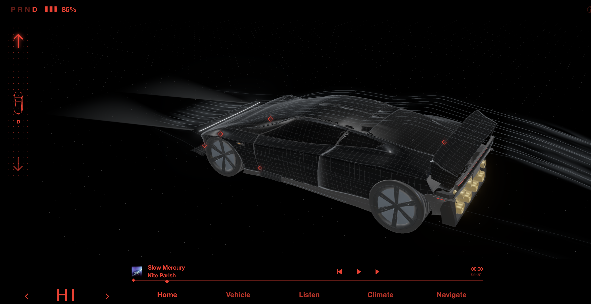

# Roadster Cockpit

A browser-based, interactive Roadster cockpit prototype reconstructed from public demonstrations, with a 3D vehicle rendered in Three.js.

This is an unofficial project with no affiliation with Tesla. It does not connect to a real vehicle: controls, maps, telemetry, and charging values are simulated.

**[Try the live demo](https://roadster-ui.pages.dev/)**

## Preview



Example cockpit view with airflow visualization. The current source build and live demo use generated gradient album artwork, which differs from the artwork shown in this historical screenshot.

## Features

- Drag to orbit the vehicle, scroll to zoom, and use touch controls to shift gears. Camera views follow the selected menu.
- Explore vehicle presets, lighting, aerodynamic components, charging limits, brightness, and themes.
- Open the track interface and hold Boost for visual effects and synthesized audio.
- Browse a simulated local map and a visual music player interface without music playback.
- Use desktop and mobile layouts, with a Tencent Video fullscreen entry point.

The fullscreen entry point leaves this site and redirects through Tencent Video and 1905. Availability and compatibility with the Tesla browser depend on those services. The app stores display preferences locally and has no account system or vehicle-data upload feature. Cloudflare processes network requests as the hosting provider and may collect network error diagnostics depending on its configuration.

## Getting started

Requires Node.js 22 or later, npm, and a browser with WebGL support.

```sh
npm ci
npm start
```

Open [http://127.0.0.1:4178](http://127.0.0.1:4178). `npm start` builds `dist/` and starts a static server that listens only on localhost and serves only the build output. Restart it after changing source files. Set the `PORT` environment variable to use a different port.

## Build and test

```sh
npm run build
npm run test:unit
npx playwright install chromium
npm run test:browser
npm run check:public
```

`npm test` runs the unit tests, build, and browser regression suite in sequence. Browser results are written to the ignored `test-results/public-release/` directory; set `QA_OUTPUT_DIR` to override it. Software rendering without a GPU can be slow, so its frame rate is not representative of normal browser performance.

The browser suite covers model loading, core interactions, security headers, CSP enforcement, and excluded paths. Fullscreen redirects are intercepted locally during testing, without requesting the real third-party pages. These tests do not replace validation in an actual Tesla vehicle.

## Deploy to Cloudflare Pages

Use `npm ci && npm run build` as the build command and `dist` as the output directory. Upload only the contents of that directory.

The live demo is published through Cloudflare Pages Direct Upload. Releases are built from the same commit published on this repository's `main` branch; pushing to GitHub alone does not deploy the site. Before uploading a release, run the tests and public-file check above, then build from a clean checkout of the published commit. Verify the deployed files against that build after uploading.

[`_headers`](_headers) configures Content Security Policy, Permissions Policy, Referrer Policy, and framing restrictions for static pages and assets. [`404.html`](404.html) makes unknown paths return a 404 response. The build contains only runtime files and the Three.js license.

This repository retains the core Pages features and excludes research archives, development and debug pages, legacy audio, account credentials, deployment tokens, and private server configuration. The source build and live demo use generated gradients instead of video-derived album covers. Documentation screenshots are not included in the Pages build.

Browsers must download JavaScript, images, and GLB assets to display the app. Removing download buttons does not prevent visitors from saving those files.

## Project structure

- `src/` — application logic, styles, 3D scenes, and interactions.
- `assets/` — the vehicle model required at runtime; album covers are generated in code.
- `data/ui-spec.json` — interface data used at runtime.
- `scripts/` — build tools, static preview server, public-file checks, and tests.
- `docs/screenshots/` — screenshots used in this README.
- [`ASSETS.md`](ASSETS.md) — asset provenance and licensing status.
- [`THIRD_PARTY_NOTICES.md`](THIRD_PARTY_NOTICES.md) — third-party dependency notices.

## License and assets

Original source code and documentation text are available under the [MIT License](LICENSE), including the code that generates gradient album covers. Third-party dependencies retain their own licenses.

The vehicle model and visual assets shown in screenshots are documented separately in [ASSETS.md](ASSETS.md) and are not automatically covered by the code license. The scope of redistribution rights for the model and its embedded textures remains unconfirmed. Tesla names and marks are not licensed by this project, and publication does not imply Tesla endorsement or authorization.

## Known limitations

The model is a visual approximation based on public imagery, not official CAD, a precise scan, or engineering data. The airflow visualization is illustrative, not a CFD simulation.

Stored preferences are not yet strictly type-validated. Malformed values in same-origin browser storage may prevent initialization or alter parts of the page HTML; clearing the site's storage restores the defaults. Triggering this issue requires the ability to write to that browser storage.
